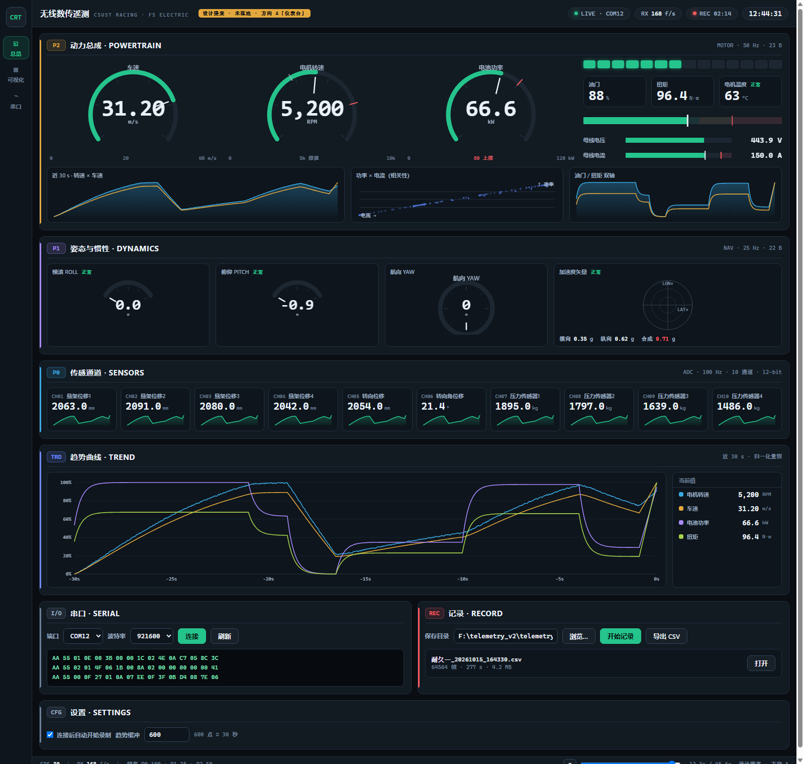
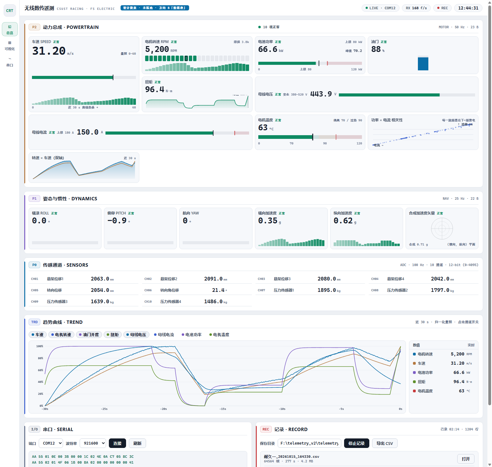
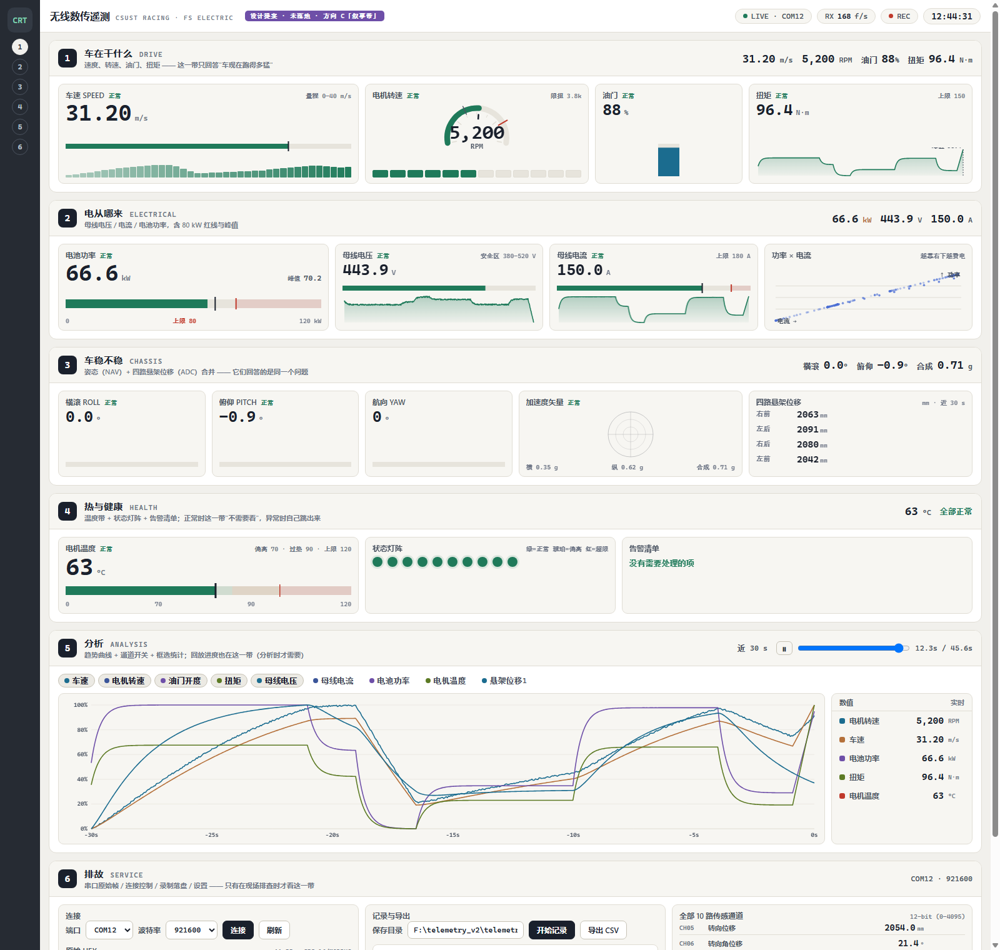

# 前端界面重设计 · 设计提案（task-26）

> **这份文档 + `design/shots/*.png` 是纯设计提案，一行产品代码都没动。**
> 验收硬指标：`git status --porcelain -- telemetry_web` 为空（已验证，见文末）。
> 原型：`design/dirA_cluster.html`（深色仪表台）/ `dirB_sheet.html`（浅色数据表）/ `dirC_bands.html`（分层叙事带），
> 共用 `design/proto.js`（数据 + canvas 绘制）。渲染驱动：`tools/_ux_mock.py` → `tools/_ux_shot.py`（Chrome headless + CDP，本机无 playwright-cli）。
> 所有原型都是**真机量级数据**：车速 31.2 m/s、转速 5,200 RPM、电压 443.9 V、电流 150.0 A、
> 功率 66.6 kW、加速度 0.35/0.62/0.71 g；并各有一份**告警态**（36.4 m/s / 7,450 RPM / 419.6 V / 202.0 A / 84.8 kW / 96 °C / 1.87 g），
> 数字之间有物理关系（`功率 = 电压×电流/1000`、`电流 ≈ 机械功率/0.9/电压`），不是各自随机的假数。

---

## 0. 先回答"动力区留白为什么消不掉"

**根因（结构性，不是样式问题）**：`#stage` 是 6 列栅格，`#zoneP2` 占列 1–4、`#zoneP1` 占列 5–6，
**两者在同一栅格行**。CSS 栅格行高 = 该行所有项的最大自然高度：

```
行高 = max(P2 自然高, P1 自然高)            # 实测 P1 ≈ 517px（矢量图 130 + 四张 dcard 287 + 头/边距）
P2 自然高 ≈ 350px                            # 四张 hcard + 四张 scard
⇒ P2 必须被拉伸到 517px，多出来的 ~167px 必然以某种方式"消失"
```

上一轮我把这 167px 交给 22px 条形去"吃掉"，用户判定为治标 —— **是对的**：
只要 P2 里还是"四张同构卡（数字 + 一条条形）+ 四张同构小卡"，
这 167px 就没有任何信息可以承载，只能变成留白或变粗的条。

**这一轮的解法：换组件，让每块空间承载不同层次的信息。**
三个方向都用同一套"信息层次"分工，但组件家族不同：

| 层次 | 回答的问题 | 谁能承载 | 三个方向各自的组件 |
|---|---|---|---|
| 粗读 | "车在干什么" | 大字形/大图形，余光可读 | A=环形表 / B=hero 大数字+速度条 / C=大数字+条 |
| 精读 | "具体多少" | 等宽数字 + 单位 + 峰值 | 数值磁贴（三者都有，但排布不同） |
| 趋势 | "刚才怎么变的" | 30 s 迷你曲线 / 热条 | A=双轴 sparkline / B=历史热条 / C=热条+sparkline |
| 相关 | "谁和谁一起动" | 散点 | 功率×电流（A/C 有） |
| 告警 | "有没有超限" | 分段带 + 阈值线 + 灯阵 + 清单 | A=灯阵+安全条 / C=灯阵+告警清单 |
| 状态 | "正不正常" | 颜色 + 徽标 | 三者：语义色 + 状态词 |

---

## 1. 组件选型表（每个量为什么用这个组件）

| 量 | 选用的组件 | 为什么是它（而不是"再来一条条形"） |
|---|---|---|
| **车速** | A：环形表（刻度+指针+中心值）<br>B/C：hero 大数字 + 速度条 + **30 s 热条** | 车速是**唯一的连续主控量**，需要"粗读 + 精读 + 趋势"三层同时在场。A 用环形把它做成"看一眼就知道多快"的仪表；B/C 把空间让给大数字与历史条 —— 工程上"刚才有没有掉速"比"指针偏角"更重要 |
| **转速** | A：环形表 + **14 段换挡灯**<br>B：**24 段 LED 分段条**（含 3.8k 限扭刻线）<br>C：半环 + 12 段灯 | 转速是**带阈值的档位量**：分段比连续条更容易读出"离换挡还有几格"。限扭线必须画在条上（3.8k），否则"该不该换挡"要自己去换算 |
| **油门** | **竖条**（A/C）+ 大数字；B 竖条 | 油门是"人给的动作"，与扭矩成对出现，竖条让它在**同一行里和扭矩视觉配对**（一个竖一个横），不会与"车自己的量"混起来 |
| **扭矩** | **sparkline + 峰值刻线** | 扭矩是**冲击性**量（换挡/落地瞬间尖峰），峰值比当前值更有用；曲线能看出"这一脚是不是突然来" |
| **电机温度** | **分段温度带 + 阈值刻线**（三者一致） | 温度是**区间语义**（正常/偏高/过热），不是线性量；三段底纹 + 阈值线让"进没进红区"变成几何问题（10px 细条上根本看不出段） |
| **母线电压/电流** | **安全区间横条 + 峰值刻线**（+ 迷你趋势） | 这两个量单独看"是多少"没有意义，有意义的是"在不在安全区"。横条把安全区画出来，电流再叠一条上限红线 |
| **电池功率** | **大数字 + 上限红线安全条**（A 另加环形） | 用户明确要求"超过 80 kW 红警"：红线必须与数值同屏；峰值保持单独显示（"这一跑最大拉到多少"） |
| **加速度矢量** | **canvas 十字靶图**（三者一致） | 横向/纵向/合成三者是**二维关系**，一维条形表达不出来 |
| **悬架 4 路** | 数值 + 热条（C 合并进"车稳不稳"） | 4 路位移放在一起才有意义（对比左右/前后），单独一路看不出问题 |
| **功率 × 电流** | 散点（A/C） | 回答"这一跑的电耗特征"：同样 60 kW 是用高压小电流还是低压大电流拿到的 —— 趋势区画折线看不出来 |
| **整体健康** | 灯阵 + 告警清单（C） | 正常时"不需要看"，异常时自己跳出来。清单把"哪些项超了"从颜色里解放出来，不用逐个找 |

---

## 2. 三个方向

### 方向 A ·「仪表台 CLUSTER」（深色，强扫视）


* **信息层级**：环形粗读（车速/转速/功率 3 个主表）→ 右侧状态列（换挡灯 + 3 磁贴 + 温度带 + 电压电流安全条）→ 底部趋势/相关层（双轴、散点、油门×扭矩）。
* **栅格**：动力区**整宽**，`3 × minmax(0,1fr) + 1.15fr`（状态列）；底部三张卡 `1.4 : 1 : 1`。姿态区 `1:1:1:1.4`，通道区 10 列等分。
* **阅读动线**：屏幕中上部 3 个圆 → 向右一列（告警）→ 底部曲线（趋势）。视线呈"Z"字，不需要长距离跳。
* **为什么更好用**：赛道边最强的是**图形记忆**——圆表的"指针位置"比数字更快判断"接近极限了没"。深色底 + 高亮数字在车库/夜赛/屏幕反光环境对比度最好。
* **操作习惯变化**：① 通道区仍是 10 列卡片（浏览方式不变）；② **趋势区通道开关仍是 chip**，位置不变；③ 无控件被移动。
* **实现成本**：中。环形表用 canvas（约 60 行），其余是 CSS + 现有 canvas 思路。**不需要后端改动**。
* **风险**：深色主题是**整页观感变化最大**的一项；用户当前的浅色习惯需要适应（可在设置里做成"亮/暗"两套 token）。

### 方向 B ·「数据表 SHEET」（浅色，高信息密度，**推荐**）


* **信息层级**：**格子大小 = 重要性**。hero（车速，3 列 × 2 行，含 34 段历史热条）→ 次（转速/功率/温度，3 列）→ 末（油门/扭矩，单列）→ 横条（电压/电流，6 列）→ 相关图与双轴图（各 3 列）。
* **栅格**：动力区内部 12 列优先级网格（1/2/3/6 列跨度），**没有"同构卡"**，因此不存在"卡片被拉高后内部留白"的问题 —— 空白由**新的信息层**（热条、峰值、区间底纹）占据。
* **阅读动线**：左上 hero（车速）→ 同排向右（转速/功率）→ 第二排（油门/扭矩/温度）→ 第三排（电气）→ 相关图。Z 字型，越靠左上越重要。
* **为什么更好用**：① 全部数值**同字号同基线**，工程师范式是"读表"不是"读图"，扫视更省；② 每格都自带"近 30 s 热条"，**不必切到趋势区**就能看出趋势；③ 浅色 + 深字是**阳光下**最容易读的组合；④ 峰值/阈值/安全区都在同一格内，误读风险最低。
* **操作习惯变化**：① 里 **主读数仍在原位**（左上），无位移；② 曲线开关 chip 位置不变；③ 新增了两处"图"（相关图、双轴图）但都在动力区内部，不抢主区。
* **实现成本**：中低。热条 = 30 个 `<i>`（CSS），其余复用 canvas 绘制；**不需要后端改动**。

### 方向 C ·「分层叙事带 BANDS」（按"车在干什么"重构信息架构）


* **信息层级**：6 条整宽带，每条回答一个问题：① 车在干什么（DRIVE）② 电从哪来（ELECTRICAL）③ 车稳不稳（CHASSIS）④ 热与健康（HEALTH）⑤ 分析 ⑥ 排故。带首固定给出"问题 + 一句话 + 当前结论"。
* **栅格**：`#stage` 从"6 列 × 8 区"改成"**整宽 6 条带**"，每条带内部再各自分列。**P0/P1/P2 的包类型分区被取消**：NAV 姿态与 ADC 悬架合并进 ③（它们回答同一个问题），电气从动力里独立成 ②。
* **阅读动线**：自上而下 = "越靠上越常用"；① 是常规驾驶时唯一必看的，④ 只有异常时看，⑥ 只有排故时看。
* **为什么更好用**：① **结构性地**消灭了"动力区被姿态区撑高"（两者不再同行，各自是整宽带）；② 按工程问题分组，新工程师不用先学"P0/P1/P2 是什么"；③ 异常集中到 ④，不必满屏找红色。
* **操作习惯变化（最大）**：① 左侧导航从"总览/可视化/串口"变成**带序 1–6**；② **姿态区从"独立分区"变成带 ③ 的一部分**（位置由右上移到中部整宽）；③ 悬架 4 路从"传感通道区"搬到带 ③；④ **回放进度条从底栏搬到"分析"带首**；⑤ 传感通道区从"10 列大卡"降级为带 ⑥ 里的一列密集表（剩余 6 路）。
* **实现成本**：**高**。需要动的不是样式而是信息架构：分区重切、导航语义改变、`showZone()` 逻辑重写。
  **并且需要配置支持**（见下节）：要知道"哪些 ADC 通道属于悬架/转向"，否则只能按 CH01–CH04 硬猜。

---

## 3. 技术可行性 & 同类坑（这部分请实现者重点看）

### 3.1 每个组件的渲染方式

| 组件 | 渲染 | 说明 |
|---|---|---|
| 环形/半环表（刻度 + 弧 + 指针 + 中心值） | **canvas** | 与产品现有矢量图/趋势图同一路线；`requestAnimationFrame` 外的离散重绘 |
| 迷你趋势 / 双轴 / 相关散点 / 趋势区 | **canvas** | 同上；脏值比对后再画 |
| 分段 LED 条、状态灯阵、历史热条、安全区间横条 | **CSS**（`<i>` + `background`） | 零 canvas 开销；只改 class，不改几何 |
| 温度分段带、竖条、峰值刻线 | canvas | 与安全条同一套 |
| 环形表的刻度字/单位 | canvas `fillText` | 不依赖 SVG 文本 |

### 3.2 ★ 指针那件事（本轮特别提醒）
产品里两个表盘的指针**从来没被画出来**，根因是 `transform="translate(a b) rotate(deg)"`
这种写法在 QtWebEngine/Chromium 下会把指针画到 SVG 盒子外面，被 `overflow:hidden` 裁掉
（证据：`tools/_ux_needle_probe.py`，Chrome 像素计数 0 → 中心式 245）。
**本提案 A 方向的环形表用 canvas 画指针，天然没有这个坑**；若实现时选 SVG，**必须**用中心式
`rotate(角度 cx cy)`，并保留 `_ux_needle_probe.py` 的 6 条断言。

### 3.3 性能红线（三个原型都遵守）
· 高频元素（20Hz）**没有** `transition > 50ms`、**没有** `will-change`、**没有** `content-visibility`
（本提案里连 22px 条都只有 `transform:scaleX` + 40ms）。
· 趋势/仪表的重绘沿用产品现有机制（脏标记 + 离散入口），**不新增每帧开销**。
· 无外部字体/CDN，中文用 `'Segoe UI','Microsoft YaHei'`，数字用 Consolas/等宽。

### 3.4 原型踩到、实现时要注意的坑（真实教训）
1. **类名冲突两次**：C 方向里 `.band` 同时用在"分带容器"和"温度带 canvas"上、`.big` 同时用在"大数字行"和"健康卡容器"上 → 前者让 canvas 被当成 flex 容器、后者把列布局变成行布局（刻度被挤成 `07090120`）。实现时**给容器和内容用不同前缀**。
2. `getBoundingClientRect` 在"整页滚动"的页面上是视口坐标，而 CDP 截图 clip 用文档坐标 —— 我在 `tools/_ux_shot.py` 里补了滚动偏移（产品页滚动在 `#stage` 内部，行为不变）。
3. 小数位/单位别写死：原型里 0/10/20/30/40 这类刻度全部由满量程推导（与产品"刻度读配置"的约定一致）。

### 3.5 ★ 需要新数据 / 需要后端或配置支持的地方
| 需求 | 现在能不能做 | 需要什么 |
|---|---|---|
| "本跑峰值"（功率/电流/车速/扭矩的峰值保持） | ✅ 纯前端 | 对 `state.buf` 取 max，零后端改动（产品已有 600 点缓冲） |
| 30 s 历史热条 / 迷你趋势 | ✅ 纯前端 | 同上 |
| 转速-车速双轴、功率-电流散点 | ✅ 纯前端 | 两条已有曲线叠加 |
| 温度分段阈值（70/90） | ✅ 已有 | `tempZone()` 按量程比例算，已配置驱动 |
| **电压安全区 380–520 V** | ⚠️ **没有配置字段** | 建议在 `UI_CFG` 增加 `voltSafeRange:[380,520]`；否则前端只能写死常量（提案里是写死的） |
| **"哪些 ADC 通道属于悬架/转向"**（C 方向把悬架并进"车稳不稳"必需） | ⚠️ **没有分组字段** | 第 3 区 `ADC_CHANNELS` 每条增加一个 `tag`（如 `susp`/`steer`/`press`）；否则只能按 CH01–CH04 猜 |
| **告警清单/灯阵的阈值清单** | ⚠️ 阈值现在散落在 `SIG`/`GAUGE_RANGES`/`tempZone` | 建议 `UI_CFG` 增加一份 `alertRules`（哪个信号、warn、over），前端统一判定 |
| 回放进度条搬到"分析"带（C） | ✅ 纯前端 | 后端接口不变（`replayProgress`/`seekReplay` 语义不变） |
| 亮/暗两套主题（A 与 B 共存） | ✅ 纯前端 | 前端 token 化即可（本轮原型已按 token 写） |

---

## 4. 我的推荐

**推荐方向 B「数据表」，并把 C 的两个思想吸收进来：**
1. **把"热与健康"做成一个独立的小带**（温度带 + 状态灯阵 + 告警清单）——这是 C 最有价值的一点，
   而它**不需要动信息架构**：把 B 里分散的温度/安全条集中成一个"健康带"即可。
2. **动力区内部按"粗读 → 精读 → 趋势"排**（B 的优先级网格已经是这个思路）。

理由（按用户的三个真实约束）：
* **阳光下**：浅色 + 深字是唯一稳妥的组合（A 的深色在强光下会变成镜子）。
* **赶时间**：B 的所有读数同字号同基线、格子大小直接编码重要性，扫视成本最低；
  A 的圆表观感最强但**读数位置分散**（三个圆的数字不同高），C 的带数多、新用户要学。
* **看得舒服/专业/干净**：B 的"细线 + 大量留白 + 等宽数字"最接近专业测试台（MoTeC/AiM 的报告页），
  而在动力区里**没有一块空白是浪费的** —— 每格都有"当前值 + 历史热条"。

**为什么不做 A 作为首选**：A 是"夜赛/仪表台"的最优解，但它是**整页观感变化最大**的方案；
如果用户更喜欢仪表感，建议 A + B 的组合（环形表放动力区粗读层，其余沿用 B 的密度），
这在本提案里是可行的（两者共用同 `proto.js`）。

**C 的定位**：它是"信息架构级"方案，收益最大（结构性消灭留白/按问题分组）但代价也最大
（导航语义 + 分区重切 + 需要 ADC 分组配置）。建议**作为第二步**：先落地 B 的视觉与动力区组件，
再单独评审是否把信息架构改成 C。

---

## 5. 交付清单

```
design/
  DESIGN.md                 ← 本文档
  proto.js                  ← 原型数据层 + canvas 绘制（环形/趋势/热条/温带/安全条/散点）
  dirA_cluster.html/.css    ← 方向 A 深色仪表台
  dirB_sheet.html/.css      ← 方向 B 浅色数据表（推荐）
  dirC_bands.html/.css      ← 方向 C 分层叙事带（信息架构重构）
  shots/
    对照_三方向.png          ← 三个方向的整页对照（推荐先看这张）
    A_整页_正常.png  A_整页_告警.png  A_动力区_正常.png  A_动力区_告警.png
    A_姿态区.png  A_分析区.png  A_顶栏底栏_topbar.png  A_顶栏底栏_footer.png
    B_*.png（同上 8 张）      ← B 的动力区与告警态是本轮重点
    C_*.png（同上 8 张）
tools/
  _ux_mock.py               ← 渲染驱动（复用 _ux_shot.py）
  _ux_shot.py               ← 本机无 playwright-cli，改走 Chrome headless + CDP（本轮补了文档坐标修正）
```

---

## 6. 不确定项

1. **A 的深色主题是否符合用户审美**：本机屏幕/环境未知，建议把"亮/暗"做成配置项而不是二选一。
2. **B 的"历史热条"是否比折线更好读**：热条省高度、能看出"密度变化"，但读不出"平滑上升 vs 锯齿"。建议在真机上让用户看一眼再定（原型里 B 的 hero 格同时给了速度条与热条）。
3. **C 的悬架分组依赖配置**：在配置补齐之前，C 只能按 CH01–CH04 硬编码，风险自负（已在 3.5 标注）。
4. **分辨率适配**：原型按 1600×1000 / 1600×1520 设计，1280 宽下的响应式未做（产品现成有 4 档断点，落地时需要补）。
5. **告警态的数据是构造的**：真机 `current` 目前恒为 0（总线电流未接通），功率实测会是 0 —— 告警态截图用的是构造数据（84.8 kW），**落地后真机上不会自动出现这个画面**，需要台架/演示模式才能复现。
